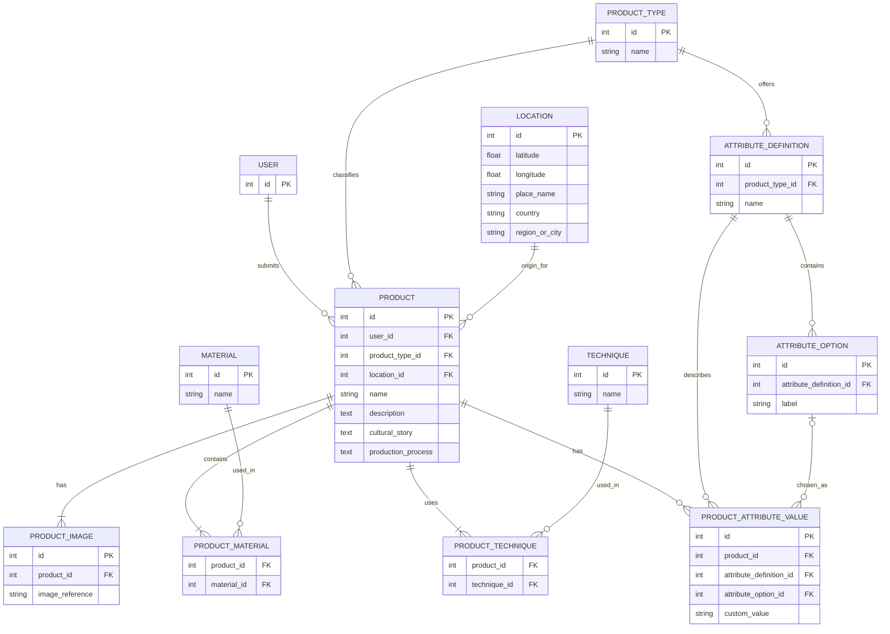

# IndigenousCraft — Initial Data Model (v1, Draft)

> **SWE573 / Issue #9** — Conceptual data model for the Cultural Crafts Portal.
> This is a **design draft**, not an implemented database schema. It will evolve as requirements are refined.

## 1. Scope and design decisions

- **Product-first information model**: the central record is an individual cultural craft **Product**, rather than a craft discipline.
- Initial **sample Product Types**: **Kilim**, **Bowl**, **Bag**, and **Necklace**. These are not a complete taxonomy.
- Every Product must provide these nine **core fields** in v1: **Name**, **Product Type**, **Description**, **Materials**, **Techniques**, **Location**, **Cultural Story**, **Production Process**, and **Images**.
- A Product can have **multiple Materials**, **multiple Techniques**, and **multiple Images**. At least one of each is needed to satisfy the corresponding required core field.
- Product Types may have **type-specific attributes** with a small set of **predefined selectable options**.
- Each attribute's option list includes **Other / Add New**. When selected, the user can type a new value, which is stored **on that Product only**; it is **not automatically shared** with other Products.
- A future administrator workflow may approve suggested options for reuse, **only under the same attribute and Product Type**. Moderation and approval implementation are **out of scope for v1**.
- Prefer a **small starting dataset** and extend the vocabulary later; do not attempt to enumerate every cultural craft or classification upfront.

## 2. Conceptual ER diagram

**Reading the diagram:** `PRODUCT_MATERIAL` and `PRODUCT_TECHNIQUE` are association entities for many-to-many choices. `PRODUCT_ATTRIBUTE_VALUE` captures a Product's attribute selection; a predefined option is referenced via `attribute_option_id`, while an **Other / Add New** entry can be stored as `custom_value` without a shared option. The selected Attribute Definition must belong to the Product's Product Type, and a selected option must belong to that definition. These cross-record constraints will be enforced when implementing the backend.

## 3. Entities and responsibilities

| Entity | Purpose |
| --- | --- |
| `User` | Person submitting products (authentication details will be designed separately). |
| `Product` | Core record with name, description, cultural story and production process. |
| `ProductType` | Broad object type; initial examples are Kilim, Bowl, Bag, Necklace. |
| `Material`, `ProductMaterial` | Reusable material options and the Product's multiple material selections. |
| `Technique`, `ProductTechnique` | Reusable technique options and the Product's multiple technique selections. |
| `Location` | Geographical/cultural origin selected on a map. |
| `ProductImage` | One or more references to product images. |
| `AttributeDefinition` | Product-Type-specific characteristic, e.g. **Pattern** for **Kilim**. |
| `AttributeOption` | Predefined selectable value, e.g. **Geometric**, **Floral**, **Striped**. |
| `ProductAttributeValue` | Value chosen (or newly entered) for an attribute of one Product. |

## 4. Example: Kilim → Pattern

1. User selects **Product Type = Kilim**.
2. Form shows **Pattern** with selectable options **Geometric**, **Floral**, **Striped**, and **Other / Add New**.
3. If the user selects **Geometric**, save a reference to the existing `AttributeOption`.
4. If the user selects **Other / Add New** and types **Diamond Motif**, store that text as a **Product-specific value**. It must **not** appear as a predefined option for another user.
5. **Later enhancement only:** an admin may approve the proposed value and add it to the shared `Pattern` options **for Kilim**. It must not appear automatically for Bowl, Bag or Necklace.

The predefined options in this example are **illustrative**, not a finalized taxonomy. Type-specific attributes are **optional extensions**; the nine common Product fields remain required.

## 5. Location / geolocation decision

- Users will select a Product's **cultural/geographical origin** using an interactive map and optionally a place search.
- Proposed mapping stack: **Leaflet** in the React frontend, **OpenStreetMap** map data, and **Nominatim** for place lookup.
- Store **latitude**, **longitude**, **place name**, and **country / region / city when available**. Cultural origins may represent a broader place rather than the item's exact manufacturing address.
- For early development, use publicly available services **only within their usage policies** (including attribution and restrictions on public Nominatim usage). Search should be **explicitly submitted**, not autocomplete on each keystroke.
- Google Maps integration is **not required** for the initial version. No location integration has been implemented yet.

## 6. Still open / later work

- [ ] Confirm this ER draft and decide details of the physical database schema.
- [ ] Define how image uploads and storage will work.
- [ ] Refine location handling for broad regions or uncertain cultural origins.
- [ ] Decide whether particular type-specific attribute selections are mandatory.
- [ ] Implement Product CRUD, form validation, and the frontend location picker.
- [ ] Design admin review of new options **later**; never publish user-entered options to shared lists automatically.
- [ ] Consider how fully new Attribute Definitions (not just new options) will be suggested in a later iteration.

**Status:** Draft — conceptual only; not yet implemented or validated against all client requirements.
